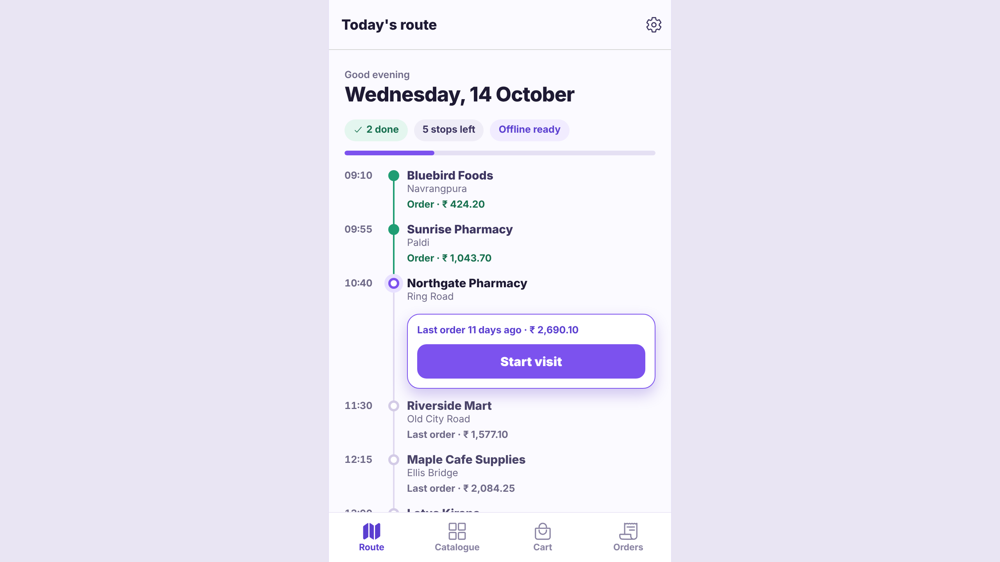
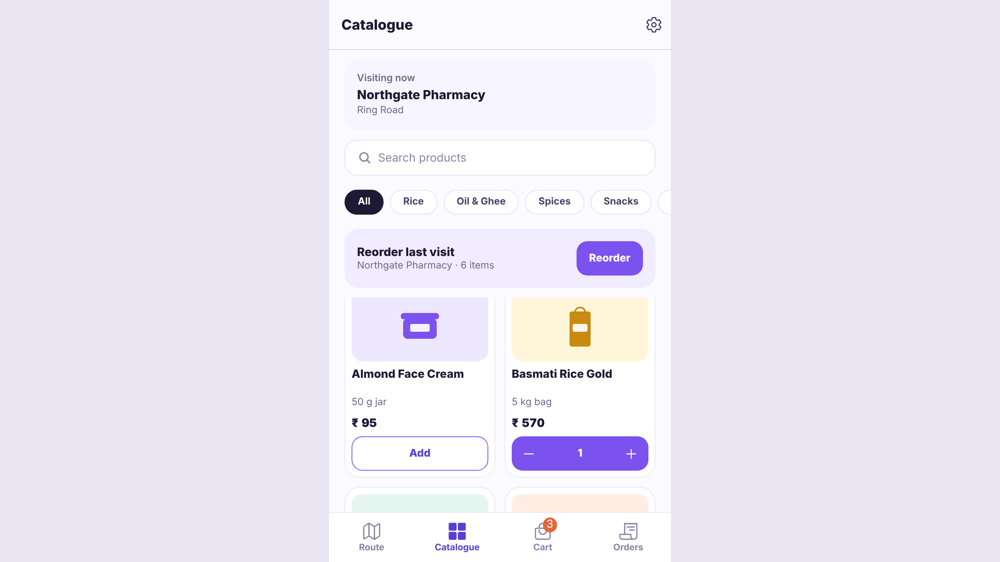
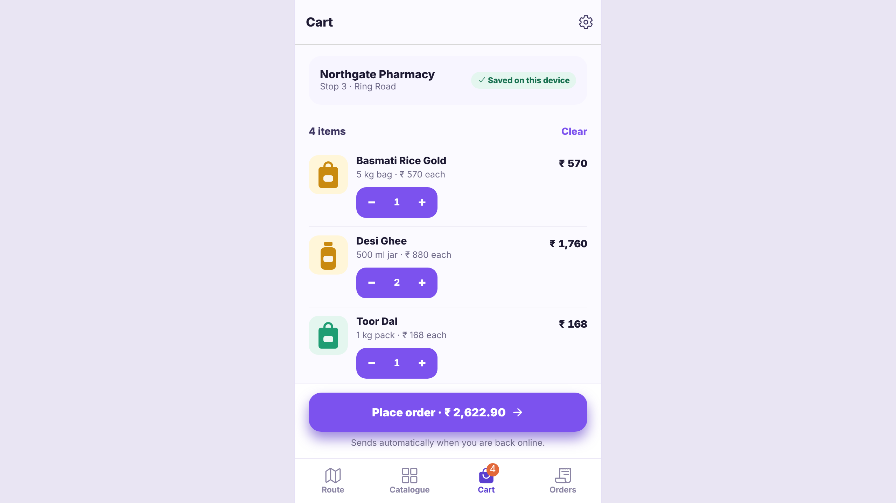
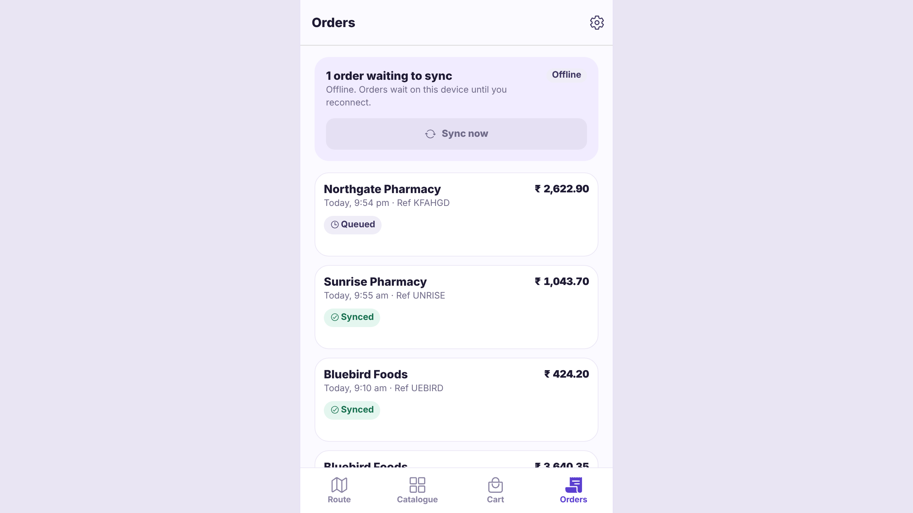
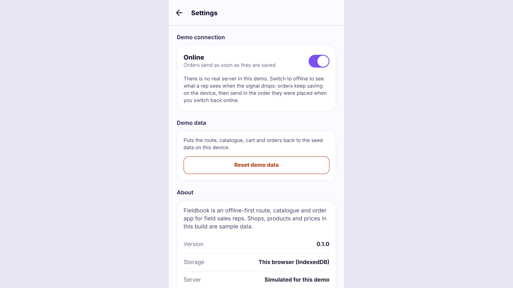
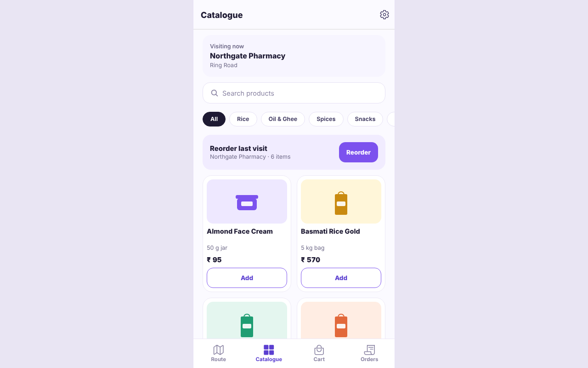
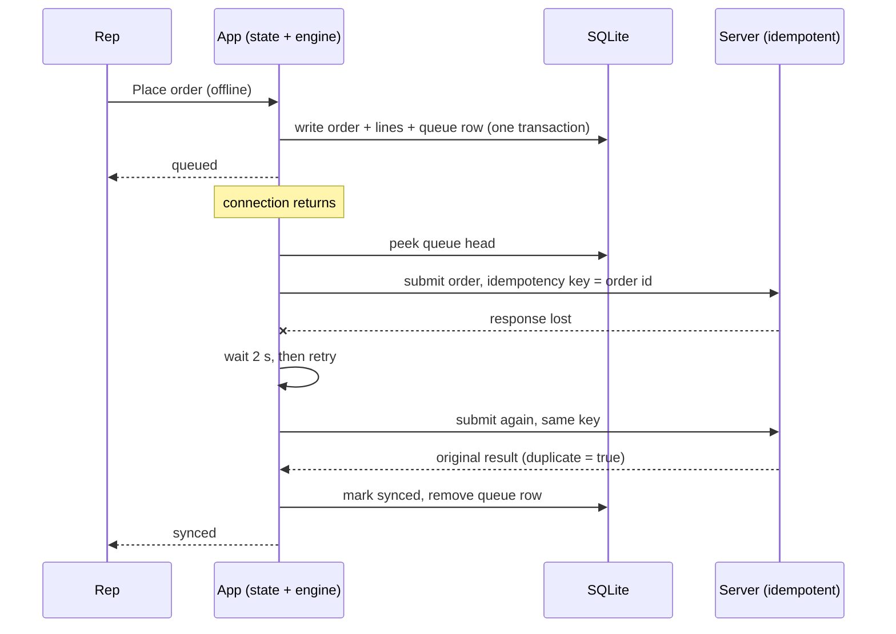

# Fieldbook

**An offline-first route, catalogue and order app for field sales reps.**

A rep works through today's route of shop visits, browses the product catalogue, builds a cart
(or reorders a shop's last visit), and places orders. Orders are written to the device first and
sync to the server in order when the connection returns. The rep never loses an order to a dead
signal.

- **Live demo (web build):** https://hardik88t.github.io/fieldbook/
- **Platforms:** iOS and Android (Expo), plus the web build used for the demo
- **Licence:** [MIT](LICENSE)

## Screenshots

<table>
  <tr>
    <td align="center"><br><sub>Route</sub></td>
    <td align="center"><br><sub>Catalogue</sub></td>
    <td align="center"><br><sub>Cart</sub></td>
    <td align="center"><br><sub>Orders</sub></td>
    <td align="center"><br><sub>Settings</sub></td>
  </tr>
</table>

<p align="center">
  
</p>

The phone screens are 390 x 844 CSS pixels at 2x. The desktop image is 1280 x 800. All of them
come from the web build, captured by the Playwright run described under [Tests](#tests).

## Features

- **Today's route.** Stops in planned order, a progress bar, an "Offline ready" chip and a
  highlighted up-next card that shows when the shop was last ordered from.
- **Catalogue.** Instant search that ignores case and diacritics, category chips, a 2-column grid,
  and a "Reorder last visit" banner that copies the shop's previous order into the cart.
- **Cart per shop.** Quantity steppers (0 to 99), a delivery note, and subtotal, GST 5% and total,
  all in integer paise. The cart is saved on the device for the shop being visited.
- **Orders that survive bad signal.** An order is saved locally in the same transaction that queues
  it. The queue sends in order (FIFO) when online, and each order carries an idempotency key.
- **Per-order status.** Queued, syncing, synced or failed, with a retry for failed orders.
- **Demo controls.** An online/offline switch in Settings (saved on the device), reset demo data,
  and an About card.
- **Accessible by default.** Labels on every touchable, targets of at least 44 px, and en-IN
  rupee formatting (`₹ 1,043.70`).

## Architecture

The rule that shapes everything: **the screen never talks to the database or the network.** Screens
call typed hooks, the hooks call repositories and the sync engine, and the repositories own the SQL.


### Offline-first data

- Everything a rep needs for the day is on the device: the route, the catalogue, the cart and every
  order. Nothing waits on the network to open a screen.
- The schema is SQLite, with migrations that are append-only (`src/data/migrations.ts`).
- Money is always an integer number of paise. Display goes through one formatter (`formatINR`).
  Totals are computed once in `src/domain/cart.ts`, so GST is never recomputed in a screen.
- The seed data is deterministic (`buildSeedData(now)`), so tests assert exact values.

### Sync queue, idempotency and retry

1. **Place order.** One transaction writes the order, its lines and a `sync_queue` row. The order
   shows as `queued` straight away, whether or not there is a connection.
2. **Flush.** When online, the engine takes the queue head and submits it with its idempotency key.
   Orders are sent one at a time, in the order they were placed, so a later order never overtakes
   an earlier one.
3. **Idempotency.** The key is the order id and it is the same on every retry. A server must treat a
   repeated key as the same order and return the original result, so a retry after a dropped
   response cannot book an order twice. `SubmitOrderResponse.duplicate` reports this case.
4. **Backoff.** A transient failure waits 2 s, then 4 s, 8 s, 16 s and so on, capped at 5 minutes.
   A single timer wakes the engine at the next due time.
5. **Parking.** A rejection, or 8 transient failures, parks the order. A parked order stays queued
   and sends only when the rep taps Retry.



### Web

The web build runs the same SQL on **sql.js** (SQLite compiled to WebAssembly) and keeps the
database file in **IndexedDB**. expo-sqlite's web build needs cross-origin isolation headers that
GitHub Pages cannot send, so the web client sits behind the same repository interface and only the
database client differs (`src/data/client.web.ts`). Each write is saved to IndexedDB before the
action resolves, so a reload never drops a change the rep has already seen.

### Deep links on GitHub Pages

Pages serves files as they exist on disk, and the app is served under `/fieldbook/`. The web export
is therefore a **single-page app** (`web.output: "single"`), not a set of pre-rendered routes.
The reasons:

- The app has no server-side data, so pre-rendering each route gives nothing. It also created a
  per-route HTML file that could disagree with the client tree. That mismatch caused React error
  #418 and "Unmatched Route" on a direct load of `/catalogue.html`.
- `scripts/finalize-web-export.mjs` runs after the export and writes a shell file for each static
  route (`catalogue.html`, `cart.html`, ...). Pages serves each one with status 200 for the clean
  URL, the trailing-slash URL and the `.html` URL. A tiny inline script rewrites a `.html` suffix
  to the clean path before the router reads it.
- It also writes `404.html`, a copy of the shell, for any other path. Pages returns it with status
  404 and the client router renders the page. The one case that cannot get a 200 is a dynamic route
  such as `/order/<id>`, because Pages cannot be told about every id. It still renders correctly.
- `.nojekyll` stops Pages running Jekyll, which would skip the `_expo/` folder.

## Tech stack

| Area       | Choice                                                                                     |
| ---------- | ------------------------------------------------------------------------------------------ |
| App        | Expo SDK 57, expo-router (file-based tabs), React 19, React Native 0.86, TypeScript strict |
| Data       | expo-sqlite on native, sql.js in IndexedDB on web, one repository layer                    |
| Sync       | `SyncTransport` interface, `FakeTransport` demo server, FIFO engine with backoff           |
| Quality    | ESLint (expo config), Prettier, `tsc --noEmit`, Jest with jest-expo, Testing Library       |
| End to end | Playwright (Chromium) against the web build                                                |
| CI and web | GitHub Actions: check job, Pages deploy                                                    |

## Running it locally

Requirements: **Node 22** and npm.

```bash
npm ci
npm start              # Expo dev server. Scan the QR code in Expo Go (iOS or Android)
npm run web            # web dev server, or press w in the Expo dev server
npm run build:web      # static export to dist/ under the /fieldbook/ base path
```

Expo Go runs the native app with the device's SQLite. The web build runs the same screens on sql.js.

## Tests

```bash
npm run check          # Prettier check, lint, typecheck and unit tests (what CI runs)
npm test               # Jest only
npm run e2e            # build the web export, then run the Playwright suite
npm run screenshots    # build, then regenerate docs/screenshots/
```

**Unit and integration tests (Jest, 219 tests).** Money and cart maths, the data layer and seed,
migrations, the sync engine (ordering, backoff, parking, idempotency, offline flush), the state
hooks, and the screens.

**End-to-end tests (Playwright, 12 tests).** They serve `dist/` under `/fieldbook/` the way Pages
does, and check:

- every route loads directly, on refresh and as `.html`, with status 200 and no console errors
- the rep flow: route, start visit, search, category, add three items, reorder, cart steppers and
  note, go offline, place the order (queued), go online (synced)
- a reload keeps the visit, the cart, the offline switch and a queued order
- no horizontal scroll on any tab at 360 px and 390 px

Playwright needs a Chromium. Run `npx playwright install chromium` once, or point
`FIELDBOOK_CHROMIUM` at an installed Chromium or headless shell.

## Project structure

```
e2e/              Playwright specs, the Pages-like static server and the screenshot capture
docs/screenshots/ README images, captured from the web build
scripts/          copy-sqljs-wasm and finalize-web-export (run by build:web)
src/app/          expo-router routes (tabs, settings, order detail, root layout)
src/components/   shared UI, grouped by screen
src/data/         schema, migrations, seed, repositories, database clients (native and web)
src/domain/       types, cart maths, search, dates
src/state/        AppProvider, typed screen hooks (the contract screens build against)
src/sync/         SyncTransport, FakeTransport, backoff, SyncEngine
src/theme/        colour, spacing, radius and type tokens
src/money.ts      paise arithmetic and en-IN formatting
.github/workflows CI (check, e2e) and the GitHub Pages deploy
```

`CONTRIBUTING.md` describes the screen contract, the commit conventions and how to add a migration.

## Deployment

Pushes to `main` run two workflows:

- `.github/workflows/ci.yml` runs the format check, lint, typecheck and unit tests, then the
  Playwright suite.
- `.github/workflows/pages.yml` builds the web export with the `/fieldbook/` base path and deploys
  it to GitHub Pages.

## Design

Fieldbook was designed and built by **Hardik Thanth**. The visual language follows the Fieldbook
reference screens: violet accent, light surfaces, rounded cards, a route timeline and a catalogue
grid. The sample shops, products and prices are invented for the demo.

## Licence

MIT. See [LICENSE](LICENSE). Copyright (c) 2026 Hardik Thanth.
