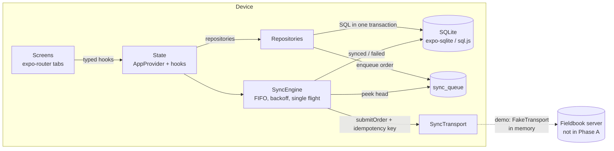

# Fieldbook

Fieldbook is an offline-first app for field sales reps at a wholesale distributor. A rep
works through today's route of shop visits, browses an offline product catalogue, builds a
cart (or reorders a shop's last visit), and places orders. Orders are written to the device
first and sync to the server in order when the connection returns.

- **Live demo (web build):** https://hardik88t.github.io/fieldbook/
- **Platforms:** iOS, Android (Expo) and the web build used for the demo.
- **Licence:** MIT

> Phase A status: the data layer, sync engine, state and navigation shell are in place. The
> screens are placeholders that Phase B fills in. See [CONTRIBUTING.md](CONTRIBUTING.md) for
> the contract screens build against.

## Features

- Today's route with stop timeline and "Start visit"
- Catalogue with instant, diacritic-insensitive search and category chips
- "Reorder last visit" from a shop's previous order
- Cart per shop, saved on the device, with GST 5% and totals in paise
- Orders queued offline, sent FIFO with idempotency keys and retry with backoff
- Per-order status: queued, syncing, synced, failed (retry)

## Architecture

Orders are written locally in the same transaction that enqueues them. A sync engine drains the
queue when online, and a server-side idempotency key stops a retried order from being booked twice.



- **Money** is integer paise everywhere. Formatting is en-IN (`₹ 1,00,000`).
- **Web** runs the same SQL on sql.js (SQLite compiled to WebAssembly) and keeps the database file in
  IndexedDB. expo-sqlite's web build needs cross-origin isolation headers that GitHub Pages cannot send.
- **Demo server:** `FakeTransport` is an in-memory server with an online toggle, latency and injected
  failures. Its state resets on page reload.

## Running it

Requirements: Node 22 and npm.

```bash
npm ci
npm start              # Expo dev server; open in Expo Go (iOS/Android) or press w for web
npm run web            # web dev server
npm run build:web      # static web export to dist/ (base path /fieldbook/)
```

## Quality checks

```bash
npm run check          # format:check, lint, typecheck, test
npm test               # Jest (jest-expo) unit and integration tests
```

Tests use an in-memory SQLite (sql.js) with the same schema as the app. They cover money and cart
maths, the data layer and seed, the sync engine (ordering, retry, parking, idempotency, offline flush)
and the state hooks.

## Repository layout

```
src/app/          expo-router routes (tabs, settings, root layout)
src/components/   shared UI
src/data/         schema, migrations, seed, repositories, database clients
src/domain/       types, cart maths, search, dates
src/state/        AppProvider, typed hooks (the screen contract)
src/sync/         SyncTransport, FakeTransport, backoff, SyncEngine
src/theme/        colour, spacing, radius and type tokens
src/money.ts      paise arithmetic and en-IN formatting
```

## Deployment

Pushes to `main` run `.github/workflows/ci.yml` (format, lint, typecheck, tests, web build) and
`.github/workflows/pages.yml` (web export deployed to GitHub Pages at `/fieldbook/`).

## Licence

MIT. See [LICENSE](LICENSE).
